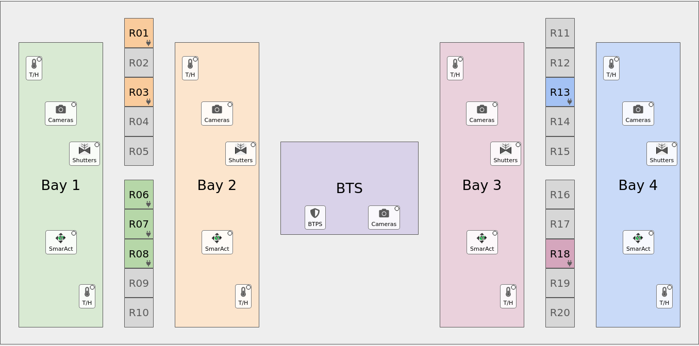

# LAS floor-plan home screen (lasdev style)

A proof of concept of the **lasdev** home-screen style applied to the **LAS** PVs: a drawing of the laser hall in which you click a bay, rack or icon to open the matching screen in a `TabDock`. The hall is drawn by Qt from `floorplan.yaml`, not from a background image.

How `lasdev` works today is in [lasdev_launch_internals.md](lasdev_launch_internals.md).

**This directory is only the location**: `floorplan.yaml` (the drawing, what each click opens, and its happi `beamline`, window `title` and `toolbar`), `las_home.py` (the home screen) and `las_home.sh` (dev launcher). The screen itself (code, device screens, `device_types.yaml`, tools) is the shared [home_screen](../home_screen/README.md) package, the same for every location.

It has **no runtime dependency on happi, ophyd, pcdsdevices, typhos or lucid**, and nothing outside `dev/` was changed.

## Run it

```bash
pcdswidgets/dev/las/las_home.sh &      # foreground without "&", like the production las_home.sh
```

Environment: `ctrlenv-widgets/v1.2.1`, with this checkout's pcdswidgets first on `PYTHONPATH`. In production (the org launcher's "Option 4"), from this directory: `pydm --hide-nav-bar --hide-menu-bar --hide-status-bar las_home.py`. **It connects to the real IOCs.**

## What you can click



| Where | Click | Opens |
|---|---|---|
| **Bay 1–4** (the coloured area) | menu | Every control in the bay, as drop-downs: Cameras, SmarAct Motors, Temperature / Humidity (from happi `location_group`), then Shutters, then Tools (that bay's buttons from the LAS toolbar). Each device entry has the dock options; clicking the entry opens it in the dock. Groups have "Open All". |
| **BTS** | menu | BTS cameras, plus the external tools BTPS Overview, BTMS Overview, Laser Hall Vacuum, Shutters, BTS motors, RGA and QPCs (marked ↗). QPCs is a sub-menu with one entry per IOC (las-pci-01 … 05), as in the toolbar. |
| **Racks** with a plug badge (R01, R03, R06, R07, R08, R13, R18) | direct | The PDU of the LAS toolbar "PDUs" button whose name ends with that rack, e.g. "Zone 1 TiSaph PSU/Chiller PDU (R07)", in `home_screen/screens/pdu_tripplite.py` in the dock. Its PV prefix and outlet count are the ones that button's EDM launch uses (`-m PRE=...`, `TrippLite_24.edl`), read from the command or the `edm-ioc-*.cmd` script it runs. A button that isn't a TrippLite PDU runs its command instead. The EDM screen stays in the toolbar's PDUs tab. Matching is automatic: add a toolbar button named "... (R12)" and R12 lights up. |
| Other racks (grey) | — | Tooltip only. No toolbar PDU button names them yet. All 20 racks (R01–R20) are always drawn, so a new "(R05)" button lights up R05 with no other change. |
| **T/H** icons | direct | That environmental sensor (`home_screen/screens/env_monitor.ui`). |
| **Cameras** / **SmarAct** icons | menu | That bay's cameras or motors (`home_screen/screens/las_basler.ui`, `home_screen/screens/smaract.py`). |
| **Shutters** icons | direct or menu | The laser-source shutter screen (new): LS1 in Bay 1, LS3/LS4 in Bay 2, LS5/LS6 in Bay 3, LS8 in Bay 4. |
| **BTPS** icon | direct | Runs the toolbar's "BTPS Overview" (`run_btps.sh`), which opens the btms-ui BTPS screen in its own window. No status dot. |

"Direct" items follow the `TabDock` conventions: a click replaces the current tab, ctrl+click opens a new tab, shift+click opens a new window, and a right click shows the options menu. External tools always open in their own window, since EDM can't be docked.

Each icon uses the same glyph pcdswidgets uses for the screen it opens: `CameraViewerStretch`'s camera, the SmarAct tip/tilt icon, pcdswidgets' fast-shutter symbol, a thermometer, a plug for PDUs, and a shield for BTPS. Each icon also has a small status dot. It shows the worst alarm (typhos colours) across the PVs of everything the icon opens; when it isn't green, hovering the icon also lists the PVs that aren't OK.

The drawing keeps its proportions and scales with the window; text stays sharp at any size. Below 75 % scale the icons drop their labels.

Under the floor plan is the full LAS toolbar (the live `lucid_config/LAS_toolbar.yaml`).

## Files

| Path | What it is |
|---|---|
| [`../home_screen/`](../home_screen/README.md) | The shared package: home screen, floor-plan code, every device screen, `home_screen/config/device_types.yaml` (device class → screen, macros, status PVs) and the tools (`gen_indicator_pvs.py`, `export_happi_devices.py`). |
| `floorplan.png` | Screenshot of the floor plan as built (documentation only). |
| `floorplan.yaml` | **All layout and behaviour**: the hall drawing (columns left to right, with relative widths, heights and colours; racks generated as R01–R20 in coloured groups of five), icon positions (percent of their area), what each opens, laser source → bay, bay tools, and `reference_height` (the drawing height at icon scale 1.0, the old `bg.png`'s 659 px). A rack can override the automatic match with its own `opens:` list. Its `toolbar:` is the live `/cds/group/pcds/epics-dev/screens/pydm/lucid_config/LAS_toolbar.yaml`: a renamed button the floor plan refers to shows as "(missing)". Defaults (menu `functions`, colours) come from the package. Edit this to move or add things; no code changes needed. |
| `las_home.py` | The home screen: the shared `home_screen/example/example_home.py`, opening this directory's `floorplan.yaml`. Production runs it directly with pydm. |
| `las_home.sh` | Dev launcher: this location's `subnet_check` arguments, then `../home_screen/launch_home.sh las_home.py` (ctrlenv-widgets, this checkout's pcdswidgets on `PYTHONPATH`). |


## Config entry types (`opens:`)

```yaml
- device: las_lhn_bay1_env_sens_1                        # a happi device, via home_screen/config/device_types.yaml
- devices: {location: [Bay 3], function: [cameras]}      # all matching happi devices, as a sub-menu
- shutter: LS5                                           # the laser_shutter.ui screen for that source
- screen: laser_shutter.ui                               # any pydm screen in screens/ (or an absolute path)
  macros: {LS: LS1, TITLE: LS1 (Bay 1)}
  title: LS1 Shutter
- toolbar: ["Bays 3/2", "Bay 3 Delay Feedback"]          # run a LAS toolbar button's command (external)
- toolbar: ["NEH Beam Transport", "BTS QPCs", "las-pci-02"]   # one command of a button with several titles
```

A toolbar button with several titled commands (like "BTS QPCs") becomes a sub-menu with one entry per title, unless a title is given.

One entry means a click opens it directly; several mean a click shows a menu.

## Where the data came from

| What | Source |
|---|---|
| Bay devices | happi `db.json`, grouped by `location_group` and `functional_group`. "Bay 2 - 1um" and "Bay 2 - 800nm" count as Bay 2. "Beam Transport" goes to the BTS area. |
| Rack → PDU | the LAS toolbar "PDUs" tab: each button whose name ends in "(Rxx)" belongs to rack Rxx; the PDU prefix is the `PRE` its EDM launch passes. |
| Laser source → bay | BTPS screen tab names ("LS3 (Bay 2 1um)", ...) |
| Shutter PVs | `pcdsdevices.lasers.btps` (`LTLHN:LSn:LST:*`, `LTLHN:LSn:BTPS:*`) |
| Bay tools | LAS toolbar "Bays 3/2" tab |

## Tests

This location has no tests of its own: the [home_screen](../home_screen/README.md#tests) package's core tests check every location's `floorplan.yaml` (references resolve, every happi device is in exactly one menu, status PVs are filled in, toolbar commands) against its toolbar and its happi snapshot, `home_screen/tests/snapshots/las.yaml`.

## Known gaps / next steps

- **Not tested against live IOCs.** The shutter PVs have only been checked offline.
- **7 labelled racks have no PDU yet**: R02, R04, R11, R12, R16, R17 and R19. They, and the other unused rack numbers, are drawn grey and light up automatically once the toolbar has a "... (Rxx)" PDU button for them.
- **Racks open only the PDU** (`pdu_tripplite.py`, not live-tested). The original design sketch mentioned "maybe some monitoring, or all of the controls in it". Rack entries already accept a list of `opens`, so adding more is a config change.
- **Icon positions are rough.** Fine-tune them in `floorplan.yaml` (`at: [x %, y %]` within their area).
- **SmarAct screens are pinned to R4.0.0.** When `ioc-las-bts-mcs1` moves to a new release, update `SMARACT_SCREENS` in `home_screen/screens/smaract.py`, or pass it as a macro.
- **Mixed data sources.** Rack → PDU comes from the toolbar labels, while `ioc-las-lhn-pwr-02.cfg` says "LHN Timing PDU Bay 2" for the PDU the toolbar calls "Zone 2 OPCPA Controls PDU (R03)". Confirm with the LAS team.
