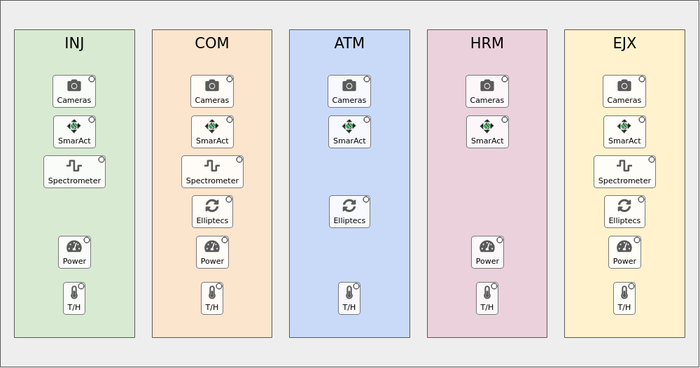

# CRIX MODS (LM2K2) floor-plan home screen

A pcdswidgets rebuild of the `mods_crix` home screen: a drawing of the CRIX MODS table, with its optical stations in beam order: INJ (Injection) → COM (Compression) → ATM (Arrival Time Monitor) → HRM (Harmonics) → EJX (Ejection), in the order of their numbered happi location groups. Click a station or an icon to open the matching screen in a `TabDock`. It is a copy of `dev/mods_ip1` (same code and screens) with the CRIX_MODS config: its floor plan, toolbar and happi snapshot.

**This directory is only the location's config**: `config/floorplan.yaml` (the drawing, what each click opens, and its happi `beamline`, window `title` and `toolbar`), the toolbar copy, the launcher and its tests. The screen itself (code, device screens, `device_types.yaml`, tools) is the shared [home_screen](../home_screen/README.md) package, the same for every location.

It has **no runtime dependency on happi, ophyd, pcdsdevices, typhos or lucid**, and nothing outside `dev/` was changed.

## Run it

```bash
pcdswidgets/dev/mods_crix/mods_crix_home.sh &      # foreground without "&", like the production launchers
pcdswidgets/dev/mods_crix/mods_crix_home.sh -m '{"TOOLBAR": "/cds/group/pcds/pyps/apps/hutch-python/lucid_config/CRIX_MODS_toolbar.yaml"}' &   # live toolbar
```

Environment: `ctrlenv-widgets/v1.2.1`, with this checkout's pcdswidgets and `dev/home_screen` first on `PYTHONPATH`. **It connects to the real IOCs.**

## What `mods_crix` runs today

```
mods_crix                                  (bash function, /cds/group/pcds/setup/pcds_shortcuts.sh:423)
 ├─ subnet_check crix las rix              (read-only / write-enabled message)
 └─ $PYPS_SITE_TOP/config/las/mods_crix_home.sh &
      └─ $EPICS_SETUP/lucid-launcher.sh CRIX_MODS          ("Option 2: lucid launcher with dev_conda")
           └─ lucid CRIX_MODS --toolbar=$LUCID_CONFIG/CRIX_MODS_toolbar.yaml
```

LUCID builds a grid of every active happi device with `beamline: CRIX_MODS`, grouped by `location_group` × `functional_group`, and opens typhos screens. This rebuild uses the same happi data, the same toolbar and the same `subnet_check`.

## What you can click



| Where | Click | Opens |
|---|---|---|
| **Station** (INJ, COM, ATM, HRM, EJX) | menu | Every control in the station, as drop-downs by function (Cameras, SmarAct Motors, Spectrometers, Elliptecs, Power Meters, Temperature / Humidity). Groups have "Open All". |
| **Cameras** / **SmarAct** / **Spectrometer** / **Elliptecs** / **Power** icons | menu | That station's devices of that function. |
| **T/H** icons | direct | That station's environmental sensor (`home_screen/screens/env_monitor.ui`). |

Station → happi location groups: INJ `1_lm2k2_inj`, COM `2_lm2k2_com`, ATM `3_lm2k2_atm`, HRM `4_lm2k2_hrm`, EJX `5_lm2k2_ejx`. No station has tools: no CRIX_MODS toolbar button belongs to one station (the Dispersion Scan runs `run-crix.sh`), so every button (LCLS Home, Cam Viewer, iocmanager, Dispersion Scan, the TPRs, the digitizers) is only in the toolbar. There are no shutters in the toolbar, so no shutter icons.

"Direct" items follow the `TabDock` conventions: a click replaces the current tab, ctrl+click opens a new tab, shift+click opens a new window, and a right click shows the options menu. External tools always open in their own window.

Each icon has a small status dot: the worst alarm (typhos colours) across the PVs of everything it opens. When it isn't green, hovering the icon also lists the PVs that aren't OK. The drawing keeps its proportions and scales with the window; below 75 % scale the icons drop their labels.

Under the floor plan is the full CRIX_MODS toolbar (`config/crix_mods_toolbar.yaml`, a copy of `lucid_config/CRIX_MODS_toolbar.yaml`).

## Device screens

76 active devices, 10 classes:

| Class | Count | Screen |
|---|---|---|
| `SmarAct` | 23 | `home_screen/screens/smaract.py`, the IOC release's own widgets (`common/smaract/R4.0.0`) |
| `SmarActTipTilt` (14), `SmarActEncodedTipTilt` (1) | 15 | `home_screen/screens/tip_tilt.py`, pcdswidgets' `MotorTipTiltDouble`: d-pad, step size and position per axis, invert, per-axis expert buttons. Tip (`{prefix}{tip_pv}`) is left/right, tilt is up/down. Open-loop stages use the SmarAct step fields; the encoded one (HRM MP3 MR2, `STYLE: MotorRecord`) its motor records |
| `LasBasler` | 15 | `home_screen/screens/las_basler.ui` (camera viewer + settings panel `home_screen/screens/las_basler_settings.ui`) |
| `EllRotation` (5), `EllLinear` (3), `Ell6` (2) | 10 | `home_screen/screens/elliptec.py` + `elliptec.ui`, one screen for every Thorlabs Elliptec (thorlabs-ell IOC, PVs `{prefix}:M{channel}:...`). The `STAGE` macro (`continuous`, `ell6`, `ell9`) drops the sections whose records that stage type doesn't load. Scrolls in a short dock |
| `EnvironmentalMonitor` | 5 | `home_screen/screens/env_monitor.ui` |
| `El3174AiCh` | 5 | `home_screen/screens/power_meter.ui` (from mods_ip1; EL3174 analog-input channels): large `.VAL` readout with units, 5-minute trend, calibration fields |
| `QminiSpectrometer` | 3 | `home_screen/screens/qmini.py`, the IOC release's own embedded screen (`common/qmini/R3.1.1/qminiScreens/QminiSpectrometer.embedded.py`). Scrolls in a short dock |

`home_screen/config/device_types.yaml` is mods_ip1's. It keeps `Ell9` (none in CRIX_MODS today), which `elliptec.py` supports, so an Ell9 added to happi just works.

Every active class has a screen. A class without `screen:` in `home_screen/config/device_types.yaml` opens a placeholder (name, class, prefix, "no screen yet") and still has a status dot.

### Per-device happi kwargs

Tip/tilt stages and Elliptecs can't be described by `{prefix}` alone: their PVs depend on happi kwargs (`tip_pv: '{{ioc_tip_suffix}}'`, `channel: '{{ioc_channel}}'`, `port: '15'`). `devices.py` keeps each entry's kwargs, with the `{{field}}` templates filled in from the entry, and makes them available as `{tip_pv}`, `{channel}`, ... in `device_types.yaml`. For example, `LM2K2:COM_MP2_MR4` with `tip_pv: _TIP1` gives `{prefix}{tip_pv}:STEP_COUNT` → `LM2K2:COM_MP2_MR4_TIP1:STEP_COUNT`. `home_screen/tools/gen_indicator_pvs.py` builds such classes with the placeholders listed under `template_kwargs:`.

## Files

| Path | What it is |
|---|---|
| [`../home_screen/`](../home_screen/README.md) | The shared package: home screen, floor-plan code, every device screen, `home_screen/config/device_types.yaml` (device class → screen, macros, status PVs) and the tools (`gen_indicator_pvs.py`, `export_happi_devices.py`). |
| `config/floorplan.yaml` | **All layout and behaviour**: the drawing (stations left to right, relative widths/heights, colours, preferred height), station → location groups and tools, icon positions (percent of their station) and what each opens. Edit this to move or add things; no code changes needed. |
| `mods_crix_home.sh` | Launcher: sets this location's `subnet_check` arguments and runs `../home_screen/launch_home.sh` with `config/floorplan.yaml` (ctrlenv-widgets, this checkout's pcdswidgets and the package on `PYTHONPATH`; `HOME_SCREEN_DIR` to use another copy of the package). |
| `config/crix_mods_toolbar.yaml` | The toolbar (copy of `lucid_config/CRIX_MODS_toolbar.yaml`, taken 2026-11-05). Shown under the floor plan; station tools would refer to it by tab and button (none today). **When deploying, switch to the live file** (e.g. via the `TOOLBAR` macro); a renamed button the floor plan refers to then shows as "(missing)". |
| `floorplan.png` | Screenshot of the floor plan (documentation only). |
| `tests/` | pytest-qt tests (36). `tests/devices_snapshot.yaml` is a dated snapshot of the 76 active CRIX_MODS happi entries that the tests use instead of the live database. |

## Config entry types (`opens:`)

```yaml
- device: lm2k2_inj_env_sens                                  # a happi device, via config/device_types.yaml
- devices: {location: [5_lm2k2_ejx], function: [elliptecs]}   # all matching happi devices, as a sub-menu
- screen: env_monitor.ui                                      # any pydm screen in screens/ (or an absolute path)
  macros: {PREFIX: LM2K2:INJ_BHC_AI_01, NAME: inj}
  title: INJ T/H
- toolbar: [Tools, Dispersion Scan]                           # run a toolbar button's command (external)
- toolbar: [Tools, <button>, <title>]                         # one command of a button with several titles
```

One entry means a click opens it directly; several mean a click shows a menu.

## Tests

```bash
cd pcdswidgets/dev/mods_crix
QT_QPA_PLATFORM=offscreen PYTHONPATH=../.. \
  /reg/g/pcds/pyps/pixi/ctrlenv-widgets/v1.2.1/src/rhel9-x86_64/.pixi/envs/default/bin/python -m pytest tests -q
```

The tests point channel access at `127.0.0.1` only, use the YAML device snapshot, and replace `run_command` so no external window is ever launched. They check that:

- every config reference resolves, and every icon has something to open
- every active CRIX_MODS device appears in exactly one station menu, and every active class has a device type
- stations are in beam order, and icons sit inside their station without overlapping
- the station menus contain the expected entries
- multi-command toolbar buttons split by title
- icon clicks open the right screen in the dock
- status dots fill in per-device happi kwargs (tip/tilt suffixes, Elliptec channels), and the icon tooltip lists bad PVs
- spectrometers open the Qmini screen, which scrolls in a short dock; tip/tilts open the tip/tilt screen with the right axes; the power meter screen fits the dock; each Elliptec type gets exactly its sections; classes without a screen open the placeholder
- icons shrink with the drawing; at the minimum window size no toolbar tab scrolls
- screens taller than the dock (SmarAct, camera) scroll in it, and the window keeps its height
- the screens load with all macros filled
- the home screen imports nothing forbidden, and nothing from `dev/` but the `home_screen` package

## Known gaps / next steps

- **Spectrometer status dots watch big waveforms.** `QminiSpectrometer`'s generated `indicator_pvs` include `:SPECTRUM` and `:WAVELENGTHS` (the same signals typhos watched). They work, but each update is a full array; trimming them to `:STATUS` / `:W0_FIT` would be cheaper. `gen_indicator_pvs.py` would put them back on the next run, so this needs a small exclude option there first.
- **Station layout is schematic** (equal boxes in beam order), not the real table. Fine-tune widths, heights and icon positions in `config/floorplan.yaml`, or replace with a sketch of the table.
- **Station order** follows the happi location-group numbers (ATM 3, HRM 4); reorder `hall: columns:` if the table is laid out differently.
- **Not yet tried against the live LM2K2 IOCs.** The code and screens are the ones tested live on IP1; the CRIX config (floor plan, snapshot, toolbar) has only been checked offline.
