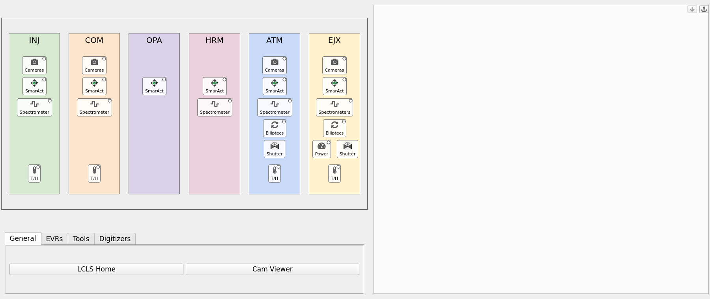

# IP1 MODS (LM1K4) floor-plan home screen

A pcdswidgets rebuild of the `mods_ip1` home screen: a drawing of the IP1 MODS table, with its optical stations in beam order (INJ → COM → OPA → HRM → ATM → EJX). Click a station or an icon to open the matching screen in a `TabDock`. It is built from the `dev/las` template and follows the same structure.

**It is standalone**: everything it needs is in this directory. It only needs a pcdswidgets (from `PYTHONPATH` or the environment) and PyDM.

It has **no runtime dependency on happi, ophyd, pcdsdevices, typhos or lucid**, and nothing outside `dev/` was changed.

## Run it

```bash
pcdswidgets/dev/mods_ip1/mods_ip1_home.sh &      # foreground without "&", like the production launchers
pcdswidgets/dev/mods_ip1/mods_ip1_home.sh -m '{"TOOLBAR": "/cds/group/pcds/pyps/apps/hutch-python/lucid_config/IP1_MODS_toolbar.yaml"}' &   # live toolbar
```

Environment: `ctrlenv-widgets/v1.2.1`, with this checkout's pcdswidgets and `dev/mods_ip1` first on `PYTHONPATH`. **It connects to the real IOCs.**

## What `mods_ip1` runs today

```
mods_ip1                                  (bash function, /cds/group/pcds/setup/pcds_shortcuts.sh:409)
 ├─ subnet_check ip1 las tmo              (read-only / write-enabled message)
 └─ $PYPS_SITE_TOP/config/las/mods_ip1_home.sh &
      └─ $EPICS_SETUP/lucid-launcher.sh IP1_MODS          ("Option 2: lucid launcher with dev_conda")
           └─ lucid IP1_MODS --toolbar=$LUCID_CONFIG/IP1_MODS_toolbar.yaml
```

LUCID builds a grid of every active happi device with `beamline: IP1_MODS`, grouped by `location_group` × `functional_group`, and opens typhos screens. This rebuild uses the same happi data, the same toolbar and the same `subnet_check`.

## What you can click



| Where | Click | Opens |
|---|---|---|
| **Station** (INJ, COM, OPA, HRM, ATM, EJX) | menu | Every control in the station, as drop-downs by function (Cameras, SmarAct Motors, Spectrometers, Elliptecs, Power Meters, Temperature / Humidity), then Tools (that station's toolbar buttons). Groups have "Open All". |
| **Cameras** / **SmarAct** / **Spectrometer** / **Elliptecs** / **Power** icons | menu | That station's devices of that function. |
| **T/H** icons | direct | That station's environmental sensor (`screens/env_monitor.ui`). |
| **Shutter** icons (ATM, EJX) | direct | The toolbar's "ATM / EJX non-LSS Shutter" (opens in its own window). No status dot. |

Station → happi location groups: INJ `1_lm1k4_inj`, COM `2_lm1k4_com`, OPA `3_lm1k4_opa`, HRM `3_lm1k4_hrm` + `4_lm1k4_hrm` + `4_lm1k4_int`, ATM `5_lm1k4_atm`, EJX `6_lm1k4_ejx`. Station tools: INJ "WFS Expert Screen"; COM and ATM their own "nf-ff-alignment" command (COM_DP1 / ATM_DP1); ATM and EJX their non-LSS shutter.

"Direct" items follow the `TabDock` conventions: a click replaces the current tab, ctrl+click opens a new tab, shift+click opens a new window, and a right click shows the options menu. External tools always open in their own window.

Each icon has a small status dot: the worst alarm (typhos colours) across the PVs of everything it opens. When it isn't green, hovering the icon also lists the PVs that aren't OK. The drawing keeps its proportions and scales with the window; below 75 % scale the icons drop their labels.

Under the floor plan is the full IP1_MODS toolbar (`config/ip1_mods_toolbar.yaml`, a copy of `lucid_config/IP1_MODS_toolbar.yaml`).

## Device screens

59 active devices, 11 classes:

| Class | Count | Screen |
|---|---|---|
| `SmarAct` | 14 | `screens/smaract.py`, the IOC release's own widgets (`common/smaract/R4.0.0`, what `ioc-lm1k4-mcs2-*` build against) |
| `LasBasler` | 13 | `screens/las_basler.ui` (camera viewer + settings panel `screens/las_basler_settings.ui`) |
| `QminiSpectrometer` | 6 | `screens/qmini.py`, the IOC release's own embedded screen, what LUCID opens (`common/qmini/R3.1.1/qminiScreens/QminiSpectrometer.embedded.py`): spectrum and fit plot, single exposure, save spectrum; "Parameters" / "Fit Settings" open floating windows. In a scroll area, so a short dock scrolls instead of squashing it |
| `SmarActTipTilt` (12), `SmarActEncodedTipTilt` (1) | 13 | `screens/tip_tilt.py`, pcdswidgets' `MotorTipTiltDouble`: d-pad, step size and position per axis, invert, per-axis expert buttons. Tip (`{prefix}{tip_pv}`) is left/right, tilt is up/down, as in pcdsdevices' screen. Open-loop stages use the SmarAct step fields; the encoded one (`STYLE: MotorRecord`) its motor records |
| `EnvironmentalMonitor` | 4 | `screens/env_monitor.ui` |
| `El3174AiCh` | 1 | `screens/power_meter.ui` (the EJX power meter, an EL3174 analog-input channel): large `.VAL` readout with units, 5-minute trend, calibration fields (raw ADC, units, slope, offset, conversion, precision) |
| `EllRotation` (4), `Ell9` (2), `EllLinear` (1), `Ell6` (1) | 8 | `screens/elliptec.py` + `elliptec.ui`, one screen for every Thorlabs Elliptec (thorlabs-ell IOC, PVs `{prefix}:M{channel}:...`): status, current position, move to, jog, jog step, home / optimize / clean / stop, position names, stage info. The `STAGE` macro (`continuous`, `ell6`, `ell9`) drops the sections whose records that stage type doesn't load (see the IOC's `st.cmd`). Scrolls in a short dock |

Every active class has a screen. A class without `screen:` in `config/device_types.yaml` opens a placeholder (name, class, prefix, "no screen yet") and still has a status dot.

### Per-device happi kwargs

Tip/tilt stages and Elliptecs can't be described by `{prefix}` alone: their PVs depend on happi kwargs (`tip_pv: '{{ioc_tip_suffix}}'`, `channel: '{{ioc_channel}}'`, `port: '15'`). `devices.py` keeps each entry's kwargs, with the `{{field}}` templates filled in from the entry, and makes them available as `{tip_pv}`, `{channel}`, ... in `device_types.yaml`. For example, `LM1K4:OPA_MP1_MR1` with `tip_pv: _TIP1` gives `{prefix}{tip_pv}:STEP_COUNT` → `LM1K4:OPA_MP1_MR1_TIP1:STEP_COUNT`. `tools/gen_indicator_pvs.py` builds such classes with the placeholders listed under `template_kwargs:`.

## Files

| Path | What it is |
|---|---|
| `config/floorplan.yaml` | **All layout and behaviour**: the drawing (stations left to right, relative widths/heights, colours, preferred height), station → location groups and tools, icon positions (percent of their station) and what each opens. Edit this to move or add things; no code changes needed. |
| `floorplan.py` | `FloorPlan` widget, `AreaButton` / `IconButton`, and `FloorPlanContext`, which turns config entries into things to open. |
| `mods_ip1_home.py` | Home screen: floor plan with the toolbar under it, `TabDock` on the right. |
| `mods_ip1_home.sh` | Launcher. Puts the pcdswidgets checkout (`PCDSWIDGETS_DIR`, default `../..`) and this directory on `PYTHONPATH`, runs `subnet_check ip1 las tmo`. |
| `devices.py` | Device list from happi's `db.json` read as plain JSON (path from `$MODS_IP1_DEVICE_DB` or `$HAPPI_CFG`) or a YAML snapshot, with each entry's happi kwargs; device types (`config/device_types.yaml`); the per-device screen cache. |
| `alarm.py` | `PVAlarmCircle`, the status dot: worst alarm across a list of PVs, in typhos's colours. |
| `config/device_types.yaml` | Device class → screen, macros, `template_kwargs` and status PVs. |
| `config/ip1_mods_toolbar.yaml` | The toolbar (copy of `lucid_config/IP1_MODS_toolbar.yaml`, taken 2026-11-05). Station tools and shutter icons refer to it by tab, button and title. **When deploying, switch to the live file** (e.g. via the `TOOLBAR` macro); a renamed button the floor plan refers to then shows as "(missing)". |
| `screens/` | `smaract.py`, `las_basler.ui`, `las_basler_settings.ui`, `env_monitor.ui` (from `dev/las`, unchanged); `qmini.py` (wraps the qmini IOC release's embedded screen); `tip_tilt.py` (pcdswidgets' `MotorTipTiltDouble`); `power_meter.ui`; `elliptec.py` + `elliptec.ui` (all Elliptecs). |
| `tools/gen_indicator_pvs.py` | **Dev-time only, uses ophyd** (run with the pcds conda python). Regenerates `indicator_pvs` in `config/device_types.yaml`. |
| `tools/export_happi_devices.py` | Regenerates `tests/devices_snapshot.yaml` from happi (`$HAPPI_CFG`, never `$MODS_IP1_DEVICE_DB`), sorted by name. No happi import; runs with any python that has PyYAML. |
| `floorplan.png` | Screenshot of the floor plan (documentation only). |
| `tests/` | pytest-qt tests (37). `tests/devices_snapshot.yaml` is a dated snapshot of the 59 active IP1_MODS happi entries that the tests use instead of the live database. |

## Config entry types (`opens:`)

```yaml
- device: lm1k4_inj_env_sens                                  # a happi device, via config/device_types.yaml
- devices: {location: [6_lm1k4_ejx], function: [elliptecs]}   # all matching happi devices, as a sub-menu
- screen: env_monitor.ui                                      # any pydm screen in screens/ (or an absolute path)
  macros: {PREFIX: LM1K4:INJ_BHC_AI_01, NAME: inj}
  title: INJ T/H
- toolbar: [Tools, EJX non-LSS Shutter]                       # run a toolbar button's command (external)
- toolbar: [Tools, nf-ff-alignment, COM_DP1]                  # one command of a button with several titles
```

One entry means a click opens it directly; several mean a click shows a menu.

## Tests

```bash
cd pcdswidgets/dev/mods_ip1
QT_QPA_PLATFORM=offscreen PYTHONPATH=../..:. \
  /reg/g/pcds/pyps/pixi/ctrlenv-widgets/v1.2.1/src/rhel9-x86_64/.pixi/envs/default/bin/python -m pytest tests -q
```

The tests point channel access at `127.0.0.1` only, use the YAML device snapshot, and replace `run_command` so no external window is ever launched. They check that:

- every config reference resolves, and every icon has something to open
- every active IP1_MODS device appears in exactly one station menu, and every active class has a device type
- stations are in beam order, and icons sit inside their station without overlapping
- the station menus contain the expected entries
- multi-command toolbar buttons (nf-ff-alignment) split by title
- station tools and shutter icons run their toolbar commands; icon clicks open the right screen in the dock
- status dots fill in per-device happi kwargs (tip/tilt suffixes, Elliptec channels), and the icon tooltip lists bad PVs
- spectrometers open the Qmini screen, which scrolls in a short dock; tip/tilts open the tip/tilt screen with the right axes; the power meter screen fits the dock; each Elliptec type gets exactly its sections; classes without a screen open the placeholder
- icons shrink with the drawing; at the minimum window size no toolbar tab scrolls
- the screens load with all macros filled
- the home screen imports nothing forbidden, and nothing from the rest of `dev/`

## Known gaps / next steps

- **Not tested against live IOCs.**
- **Spectrometer status dots watch big waveforms.** `QminiSpectrometer`'s generated `indicator_pvs` include `:SPECTRUM` and `:WAVELENGTHS` (the same signals typhos watched). They work, but each update is a full array; trimming them to `:STATUS` / `:W0_FIT` would be cheaper. `gen_indicator_pvs.py` would put them back on the next run, so this needs a small exclude option there first.
- **Station layout is schematic** (equal boxes in beam order), not the real table. Fine-tune widths, heights and icon positions in `config/floorplan.yaml`, or replace with a sketch of the table.
- **Station titles** (`stations.*.title`, shown in tooltips) use the happi location-group names; give them proper names (what COM / HRM / EJX stand for) when known.
