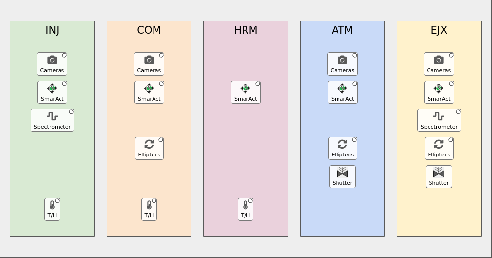

# IP2 MODS (LM2K4) home screen

The `mods_ip2` home screen on the shared [home_screen](../home_screen/README.md) package: the IP2 MODS table, stations in beam order INJ → COM → HRM → ATM → EJX. How clicking, docking and status dots work: [Using a home screen](../home_screen/README.md#using-a-home-screen).



## Run it

```bash
pcdswidgets/dev/mods_ip2/mods_ip2_home.sh &                                 # dev
pydm --hide-nav-bar --hide-menu-bar --hide-status-bar mods_ip2_home.py      # production ("Option 4"), from this directory
```

It connects to the real IOCs. Today the `mods_ip2` shell function runs `subnet_check ip2 las tmo`, then `$PYPS_SITE_TOP/config/las/mods_ip2_home.sh`, which starts LUCID.

## What you can click

| Where | Opens |
|---|---|
| **Station** | Its devices by function (Cameras, SmarAct Motors, Spectrometers, Elliptecs, Temperature / Humidity), then its Tools. |
| **Cameras** / **SmarAct** / **Spectrometer** / **Elliptecs** icons | That station's devices of that function. |
| **T/H** icons (INJ, COM, HRM) | That station's environmental sensor. ATM and EJX have none in happi. |
| **Shutter** icons (ATM, EJX) | The toolbar's "ATM / EJX non-LSS Shutter", in its own window. No status dot. |

| Station | happi location group | Tools |
|---|---|---|
| INJ | `1_lm2k4_inj` | |
| COM | `2_lm2k4_com` | |
| HRM | `3_lm2k4_hrm` | |
| ATM | `4_lm2k4_atm` | ATM non-LSS Shutter |
| EJX | `5_lm2k4_ejx` | EJX non-LSS Shutter |

## Devices

45 active devices (snapshot: `home_screen/tests/snapshots/mods_ip2.yaml`):

| Class | Count | Screen (`home_screen/screens/`) |
|---|---|---|
| `SmarAct` | 14 | `smaract.py` |
| `LasBasler` | 11 | `las_basler.ui` |
| `SmarActEncodedTipTilt`, `SmarActTipTilt` | 7 + 1 | `tip_tilt.py` |
| `EllLinear`, `Ell9`, `EllRotation` | 4 + 2 + 1 | `elliptec.py` |
| `EnvironmentalMonitor` | 3 | `env_monitor.ui` |
| `QminiSpectrometer` | 2 | `qmini.py` |
