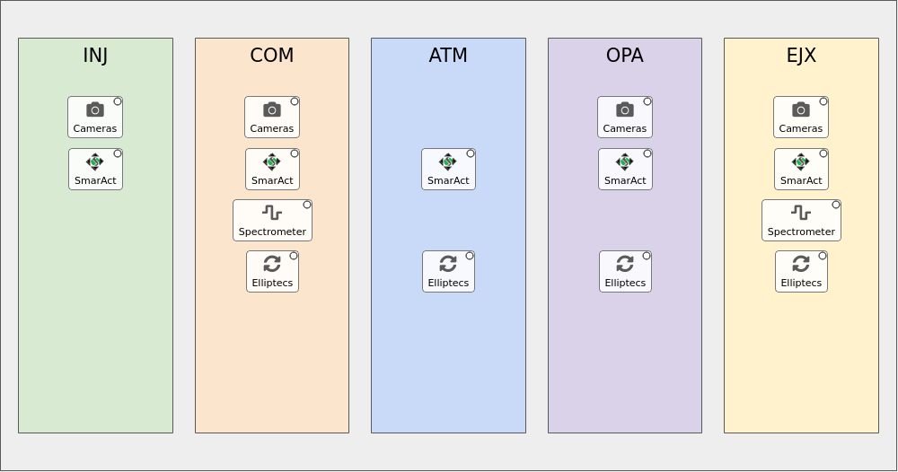

# QRIX MODS (LM1K2) floor-plan home screen

A pcdswidgets rebuild of the `mods_qrix` home screen: a drawing of the QRIX MODS table, with its optical stations in beam order: INJ (Injection) → COM (Compression) → ATM (Arrival Time Monitor) → OPA (Optical Parametric Amplification) → EJX (Ejection), in the order of their numbered happi location groups. Click a station or an icon to open the matching screen in a `TabDock`. It is a copy of `dev/mods_ip1` (same code and screens) with the QRIX_MODS config: its floor plan, toolbar and happi snapshot.

**It is standalone**: everything it needs is in this directory. It only needs a pcdswidgets (from `PYTHONPATH` or the environment) and PyDM.

It has **no runtime dependency on happi, ophyd, pcdsdevices, typhos or lucid**, and nothing outside `dev/` was changed.

## Run it

```bash
pcdswidgets/dev/mods_qrix/mods_qrix_home.sh &      # foreground without "&", like the production launchers
pcdswidgets/dev/mods_qrix/mods_qrix_home.sh -m '{"TOOLBAR": "/cds/group/pcds/pyps/apps/hutch-python/lucid_config/QRIX_MODS_toolbar.yaml"}' &   # live toolbar
```

Environment: `ctrlenv-widgets/v1.2.1`, with this checkout's pcdswidgets and `dev/mods_qrix` first on `PYTHONPATH`. **It connects to the real IOCs.**

## What `mods_qrix` runs today

```
mods_qrix                                  (bash function, /cds/group/pcds/setup/pcds_shortcuts.sh:430)
 ├─ subnet_check qrix las rix              (read-only / write-enabled message)
 └─ $PYPS_SITE_TOP/config/las/mods_qrix_home.sh &
      └─ $EPICS_SETUP/lucid-launcher.sh QRIX_MODS          ("Option 2: lucid launcher with dev_conda")
           └─ lucid QRIX_MODS --toolbar=$LUCID_CONFIG/QRIX_MODS_toolbar.yaml
```

LUCID builds a grid of every active happi device with `beamline: QRIX_MODS`, grouped by `location_group` × `functional_group`, and opens typhos screens. This rebuild uses the same happi data, the same toolbar and the same `subnet_check`.

## What you can click



| Where | Click | Opens |
|---|---|---|
| **Station** (INJ, COM, ATM, OPA, EJX) | menu | Every control in the station, as drop-downs by function (Cameras, SmarAct Motors, Spectrometers, Elliptecs), then Tools (that station's toolbar buttons). Groups have "Open All". |
| **Cameras** / **SmarAct** / **Spectrometer** / **Elliptecs** icons | menu | That station's devices of that function. |

Station → happi location groups: INJ `1_lm1k2_inj`, COM `2_lm1k2_com`, ATM `3_lm1k2_atm`, OPA `4_lm1k2_opa`, EJX `5_lm1k2_ejx`. Station tools: ATM "Dispersion Scan ATM" (by its name) and OPA "THz 1D-scan" (it scans `LM1K2:OPA_MP1_DLY1`). The other toolbar buttons (LCLS Home, Cam Viewer, Environmental Sensors, TPR, iocmanager, Dispersion Scan Pump, the digitizers) are only in the toolbar. QRIX_MODS has no environmental sensors in happi (the Raritan "Environmental Sensors" screen is a toolbar button) and no shutters, so there are no T/H or shutter icons.

"Direct" items follow the `TabDock` conventions: a click replaces the current tab, ctrl+click opens a new tab, shift+click opens a new window, and a right click shows the options menu. External tools always open in their own window.

Each icon has a small status dot: the worst alarm (typhos colours) across the PVs of everything it opens. When it isn't green, hovering the icon also lists the PVs that aren't OK. The drawing keeps its proportions and scales with the window; below 75 % scale the icons drop their labels.

Under the floor plan is the full QRIX_MODS toolbar (`config/qrix_mods_toolbar.yaml`, a copy of `lucid_config/QRIX_MODS_toolbar.yaml`).

## Device screens

42 active devices, 8 classes:

| Class | Count | Screen |
|---|---|---|
| `SmarAct` | 13 | `screens/smaract.py`, the IOC release's own widgets (`common/smaract/R4.0.0`) |
| `SmarActEncodedTipTilt` (7), `SmarActTipTilt` (4) | 11 | `screens/tip_tilt.py`, pcdswidgets' `MotorTipTiltDouble`: d-pad, step size and position per axis, invert, per-axis expert buttons. Tip (`{prefix}{tip_pv}`) is left/right, tilt is up/down. The encoded stages (`STYLE: MotorRecord`) use their motor records; the open-loop ones (COM BS7 and MR4, OPA MP1 MR2, EJX MR3) the SmarAct step fields |
| `EllRotation` (5), `EllLinear` (4), `Ell9` (1) | 10 | `screens/elliptec.py` + `elliptec.ui`, one screen for every Thorlabs Elliptec (thorlabs-ell IOC, PVs `{prefix}:M{channel}:...`). The `STAGE` macro (`continuous`, `ell6`, `ell9`) drops the sections whose records that stage type doesn't load. Scrolls in a short dock |
| `LasBasler` | 6 | `screens/las_basler.ui` (camera viewer + settings panel `screens/las_basler_settings.ui`) |
| `QminiSpectrometer` | 2 | `screens/qmini.py`, the IOC release's own embedded screen (`common/qmini/R3.1.1/qminiScreens/QminiSpectrometer.embedded.py`), in a scroll area |

`config/device_types.yaml` is mods_ip1's, without the power meter (`El3174AiCh`). It keeps `Ell6` and `EnvironmentalMonitor` (none in QRIX_MODS today), whose screens are here, so such a device added to happi just works.

Every active class has a screen. A class without `screen:` in `config/device_types.yaml` opens a placeholder (name, class, prefix, "no screen yet") and still has a status dot.

### Per-device happi kwargs

Tip/tilt stages and Elliptecs can't be described by `{prefix}` alone: their PVs depend on happi kwargs (`tip_pv: '{{ioc_tip_suffix}}'`, `channel: '{{ioc_channel}}'`, `port: '15'`). `devices.py` keeps each entry's kwargs, with the `{{field}}` templates filled in from the entry, and makes them available as `{tip_pv}`, `{channel}`, ... in `device_types.yaml`. For example, `LM1K2:COM_MP2_MR4` with `tip_pv: _TIP1` gives `{prefix}{tip_pv}:STEP_COUNT` → `LM1K2:COM_MP2_MR4_TIP1:STEP_COUNT`. `tools/gen_indicator_pvs.py` builds such classes with the placeholders listed under `template_kwargs:`.

## Files

| Path | What it is |
|---|---|
| `config/floorplan.yaml` | **All layout and behaviour**: the drawing (stations left to right, relative widths/heights, colours, preferred height), station → location groups and tools, icon positions (percent of their station) and what each opens. Edit this to move or add things; no code changes needed. |
| `floorplan.py` | `FloorPlan` widget, `AreaButton` / `IconButton`, and `FloorPlanContext`, which turns config entries into things to open. |
| `mods_qrix_home.py` | Home screen: floor plan with the toolbar under it, `TabDock` on the right. |
| `mods_qrix_home.sh` | Launcher. Puts the pcdswidgets checkout (`PCDSWIDGETS_DIR`, default `../..`) and this directory on `PYTHONPATH`, runs `subnet_check qrix las rix`. |
| `devices.py` | Device list from happi's `db.json` read as plain JSON (path from `$MODS_QRIX_DEVICE_DB` or `$HAPPI_CFG`) or a YAML snapshot, with each entry's happi kwargs; device types (`config/device_types.yaml`); the per-device screen cache. |
| `alarm.py` | `PVAlarmCircle`, the status dot: worst alarm across a list of PVs, in typhos's colours. |
| `config/device_types.yaml` | Device class → screen, macros, `template_kwargs` and status PVs. |
| `config/qrix_mods_toolbar.yaml` | The toolbar (copy of `lucid_config/QRIX_MODS_toolbar.yaml`, taken 2026-11-05). Station tools refer to it by tab and button. **When deploying, switch to the live file** (e.g. via the `TOOLBAR` macro); a renamed button the floor plan refers to then shows as "(missing)". |
| `screens/` | `smaract.py`, `las_basler.ui`, `las_basler_settings.ui`, `env_monitor.ui` (from `dev/las`, unchanged); `qmini.py` (wraps the qmini IOC release's embedded screen); `tip_tilt.py` (pcdswidgets' `MotorTipTiltDouble`); `elliptec.py` + `elliptec.ui` (all Elliptecs). |
| `tools/gen_indicator_pvs.py` | **Dev-time only, uses ophyd** (run with the pcds conda python). Regenerates `indicator_pvs` in `config/device_types.yaml`. |
| `tools/export_happi_devices.py` | Regenerates `tests/devices_snapshot.yaml` from happi (`$HAPPI_CFG`, never `$MODS_QRIX_DEVICE_DB`), sorted by name. No happi import; runs with any python that has PyYAML. |
| `floorplan.png` | Screenshot of the floor plan (documentation only). |
| `tests/` | pytest-qt tests (35). `tests/devices_snapshot.yaml` is a dated snapshot of the 42 active QRIX_MODS happi entries that the tests use instead of the live database. |

## Config entry types (`opens:`)

```yaml
- device: lm1k2_inj_env_sens                                  # a happi device, via config/device_types.yaml
- devices: {location: [5_lm1k2_ejx], function: [elliptecs]}   # all matching happi devices, as a sub-menu
- screen: env_monitor.ui                                      # any pydm screen in screens/ (or an absolute path)
  macros: {PREFIX: LM1K2:INJ_BHC_AI_01, NAME: inj}
  title: INJ T/H
- toolbar: [Tools, THz 1D-scan]                               # run a toolbar button's command (external)
- toolbar: [Tools, <button>, <title>]                         # one command of a button with several titles
```

One entry means a click opens it directly; several mean a click shows a menu.

## Tests

```bash
cd pcdswidgets/dev/mods_qrix
QT_QPA_PLATFORM=offscreen PYTHONPATH=../..:. \
  /reg/g/pcds/pyps/pixi/ctrlenv-widgets/v1.2.1/src/rhel9-x86_64/.pixi/envs/default/bin/python -m pytest tests -q
```

The tests point channel access at `127.0.0.1` only, use the YAML device snapshot, and replace `run_command` so no external window is ever launched. They check that:

- every config reference resolves, and every icon has something to open
- every active QRIX_MODS device appears in exactly one station menu, and every active class has a device type
- stations are in beam order, and icons sit inside their station without overlapping
- the station menus contain the expected entries
- multi-command toolbar buttons split by title
- station tools run their toolbar commands (a quoted argument stays whole); icon clicks open the right screen in the dock
- status dots fill in per-device happi kwargs (tip/tilt suffixes, Elliptec channels), and the icon tooltip lists bad PVs
- spectrometers open the Qmini screen, which scrolls in a short dock; tip/tilts open the tip/tilt screen with the right axes; each Elliptec type gets exactly its sections; classes without a screen open the placeholder
- icons shrink with the drawing; at the minimum window size no toolbar tab scrolls
- the screens load with all macros filled
- the home screen imports nothing forbidden, and nothing from the rest of `dev/`

## Known gaps / next steps

- **Spectrometer status dots watch big waveforms.** `QminiSpectrometer`'s generated `indicator_pvs` include `:SPECTRUM` and `:WAVELENGTHS` (the same signals typhos watched). They work, but each update is a full array; trimming them to `:STATUS` / `:W0_FIT` would be cheaper. `gen_indicator_pvs.py` would put them back on the next run, so this needs a small exclude option there first.
- **Station layout is schematic** (equal boxes in beam order), not the real table. Fine-tune widths, heights and icon positions in `config/floorplan.yaml`, or replace with a sketch of the table.
- **Station order** follows the happi location-group numbers (ATM 3, OPA 4); reorder `hall: columns:` if the table is laid out differently.
- **Not yet tried against the live LM1K2 IOCs.** The code and screens are the ones tested live on IP1; the QRIX config (floor plan, snapshot, toolbar) has only been checked offline.
