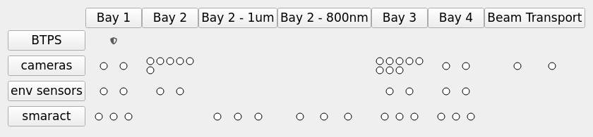

# v1: LAS home screen as a LUCID look-alike (device grid)

The first rebuild of the LUCID LAS home screen (`las` in a terminal) on pcdswidgets: the same auto-generated device grid as LUCID (happi `location_group` × `functional_group`), the LAS toolbar under it, and a `TabDock` on the right. [`dev/las`](../las/README.md) is the later floor-plan take on the same PVs. The two share their config format, device screens, scripts and tools; only the home screen differs (grid here, floor plan there).

How the current `las` command works is written up in [las_launch_internals.md](las_launch_internals.md).

**It is standalone**: everything it needs is in this directory. It only needs a pcdswidgets (from `PYTHONPATH` or the environment) and PyDM.

It has **no runtime dependency on happi, ophyd, pcdsdevices, typhos or lucid**, and nothing outside `dev/` was changed.

## Run it

```bash
pcdswidgets/dev/v1/las_home.sh &      # foreground without "&", like the production las_home.sh
pcdswidgets/dev/v1/las_home.sh -m '{"TOOLBAR": "/cds/group/pcds/pyps/apps/hutch-python/lucid_config/LAS_toolbar.yaml"}' &   # live toolbar
LAS_DEVICE_DB=pcdswidgets/dev/v1/tests/devices_snapshot.yaml pcdswidgets/dev/v1/las_home.sh &   # snapshot instead of live happi
```

Environment: `ctrlenv-widgets/v1.2.1`, with this checkout's pcdswidgets and `dev/v1` first on `PYTHONPATH`. **It connects to the real IOCs.** Write access is whatever channel access security gives your host, the same as LUCID.

## What you see



The grid, toolbar and dock behave like LUCID's (`LucidMainWindow`): grid top-left, toolbar bottom-left, an 850 px `TabDock` on the right, and a "small window mode" placeholder in place of the dock when the window is made narrower. It always opens wide enough to show the dock. Docked screens taller than the dock scroll. Menus, keybindings and docking are pcdswidgets' `IndicatorGrid` unchanged.

| Where | Click | Opens |
|---|---|---|
| A **dot** | direct | That device's screen in the dock (ctrl+click new tab, shift+click new window, right click for the options menu). Hovering shows the device name, then every PV that isn't OK. Dots have a thin black outline, as in `dev/las`. |
| The **BTPS** (shield icon, BTPS row) | direct | Runs the toolbar's "BTPS Overview" (`run_btps.sh`), which opens the btms-ui BTPS screen in its own window. No status dot. Same as `dev/las`. |
| A **row or column header** | menu | Every device in that row or column, with "Open All". The BTPS is an external entry, "BTPS Overview ↗", and "Open All" leaves it out; the BTPS row header runs it directly. |

## Device screens

44 active devices, 4 classes:

| Class | Count | Screen |
|---|---|---|
| `LasBasler` | 20 | `screens/las_basler.ui` (camera viewer + settings panel `screens/las_basler_settings.ui`). Same as `dev/las` |
| `SmarAct` | 15 | `screens/smaract.py`, the IOC release's own widgets (`common/smaract/R4.0.0`): expert panel plus the advanced-controls tabs. Same as `dev/las` |
| `EnvironmentalMonitor` | 8 | `screens/env_monitor.ui`. Same as `dev/las` |
| `BtpsState` | 1 | None: its cell runs the toolbar's "BTPS Overview" (`config/grid.yaml`), as in `dev/las` |

A class without an entry in `config/device_types.yaml` still appears in the grid. Clicking it opens a placeholder that shows its happi metadata.

## How the grid matches LUCID

- **Devices and layout**: same query (`beamline=LAS`, `active=True`), same grouping keys, same alphabetical row/column sort. That gives the same 44 devices, 4 rows and 7 columns.
- **Indicator colour**: `PVAlarmCircle` uses typhos's colours and rules: the worst severity across PVs, with disconnected counting as worst. Green no alarm, yellow minor, red major, magenta invalid, white disconnected.
- **Which PVs each indicator watches**: LUCID's circle watches a device's *hinted* signals if it has any, otherwise *hinted + normal*. `tools/gen_indicator_pvs.py` builds each class with ophyd once and records exactly those PVs:

  | Class | Level | PVs |
  |---|---|---|
  | LasBasler | normal | 10 (Acquire, DetectorState, Model, image counter, Stats2 centroid/sigma, Cross4 target) |
  | SmarAct | hinted | 1 (`.RBV`) |
  | EnvironmentalMonitor | normal | 3 (`:1/:2/:3.VAL`) |

  The BTPS has no dot (LUCID's watched its 732 hinted PVs); its overview screen shows its state.

  LasBasler also has two non-EPICS signals (`auto_configure`, `cam_viewer`). typhos treats those as always connected with no alarm, so leaving them out doesn't change the colour.

## Files

| Path | What it is |
|---|---|
| `grid.png` | Screenshot of the device grid (documentation only). |
| `las_home.py` | Home screen (PyDM `Display`): grid, toolbar and dock, with `LucidMainWindow`'s layout and resize behaviour. |
| `las_home.sh` | Launcher. Puts the pcdswidgets checkout (`PCDSWIDGETS_DIR`, default `../..`) and this directory on `PYTHONPATH`; runs `subnet_check las las`. Dev version of "Option 4: pydm home with pixi" in the org `las_home.sh`. |
| `grid.py` | `LasIndicatorGrid`: subclasses pcdswidgets' `IndicatorGrid` / `IndicatorCell` / `IndicatorGroup`, so menus, keybindings and docking are unchanged. Swaps happi → `devices.py`, `TyphosAlarmCircle` → `GridAlarmCircle` (a black-outlined `PVAlarmCircle` whose tooltip names the device), typhos screens → pydm screens, each in a scroll area (`DockScreen`) so a screen taller than the dock scrolls instead of being cut off; devices in `config/grid.yaml` run their toolbar button instead. |
| `devices.py` | Same as `dev/las`, plus `group_devices` (the grid's `location|function` groups): device list from happi's `db.json` read as plain JSON (path from `$LAS_DEVICE_DB` or `$HAPPI_CFG`) or a YAML snapshot, with each entry's happi kwargs; device types (`config/device_types.yaml`); the per-device screen cache. |
| `alarm.py` | `PVAlarmCircle`, the status dot: worst alarm across a list of PVs, in typhos's colours. Same as `dev/las`. |
| `config/device_types.yaml` | Device class → screen, macros and status PVs. Same as `dev/las`. |
| `config/grid.yaml` | Grid devices that run a toolbar button instead of opening a screen: `las_btps` → "NEH Beam Transport" / "BTPS Overview". The grid's counterpart of `dev/las`'s `opens: toolbar` entries. |
| `config/las_toolbar.yaml` | The LAS toolbar (copy of `lucid_config/LAS_toolbar.yaml`, refreshed 2026-11-05). **When deploying, switch to the live file** (e.g. via the `TOOLBAR` macro). |
| `screens/` | `smaract.py`, `las_basler.ui`, `las_basler_settings.ui`, `env_monitor.ui` (copies of `dev/las`'s). |
| `tools/gen_indicator_pvs.py` | **Dev-time only, uses ophyd** (run with the pcds conda python). Regenerates `indicator_pvs` in `config/device_types.yaml`. Same as `dev/las`. |
| `tools/export_happi_devices.py` | Regenerates `tests/devices_snapshot.yaml` from happi (`$HAPPI_CFG`, never `$LAS_DEVICE_DB`), sorted by name. No happi import; runs with any python that has PyYAML. Same as `dev/las`. |
| `tests/` | pytest-qt tests (25). `tests/devices_snapshot.yaml` is a dated snapshot of the 44 active LAS happi entries that the tests use instead of the live database. |

## Adding a device class

1. Build a screen in `screens/` with Designer, using `${MACRO}` placeholders.
2. Add the class to `config/device_types.yaml` with `screen` and `macros`. Macro templates: `{name}`, `{prefix}`, `{prefix_nocolon}`, `{doc}`, plus the device's happi kwargs (list those under `template_kwargs:`).
3. Regenerate `indicator_pvs` (needs an env with the class's ophyd code, e.g. the shared pcds conda):

   ```bash
   /cds/group/pcds/pyps/conda/py312/envs/pcds-6.0.1/bin/python -I dev/v1/tools/gen_indicator_pvs.py
   ```

## Tests

```bash
cd pcdswidgets/dev/v1
QT_QPA_PLATFORM=offscreen PYTHONPATH=../..:. \
  /reg/g/pcds/pyps/pixi/ctrlenv-widgets/v1.2.1/src/rhel9-x86_64/.pixi/envs/default/bin/python -m pytest tests -q
```

The tests point channel access at `127.0.0.1` only and use the YAML device snapshot, so they never contact a real IOC. They check that:

- the snapshot gives LUCID's grouping (rows and columns), and the JSON database is filtered like `happi search`
- every active LAS device but the BTPS has a screen, every screen is in this directory, and happi kwargs are filled in from the entry
- every screen loads with all macros filled, including embedded displays (forced to load)
- the camera screen has its settings panel, and the SmarAct screen its expert and advanced panels
- the grid builds from the snapshot (44 devices, 43 black-outlined dots), opens pydm screens, and opens a placeholder for an unknown class
- the BTPS cell and its row header run "BTPS Overview", menus list it as an external entry, and "Open All" leaves it out
- the alarm logic is correct, and a cell's tooltip names the device and lists the bad PVs
- the home screen opens with the dock showing (launched like `las_home.sh` does)
- the SmarAct and camera screens, taller than the dock at launch, scroll in it at full height instead of being cut off
- the home screen imports nothing forbidden, and nothing from the rest of `dev/`

## Known gaps / next steps

- **Not tested against live IOCs.** Run `las_home.sh` on a LAS console and compare it side by side with `las`.
- **las-console access-rights bug.** LUCID's `setup_rw_hack` forces an access-rights refresh after reconnects, because PVs on las-console sometimes come back without read/write access. That hack patches ophyd signals. PyDM widgets talk to pyepics directly and may still hit the bug. Watch for widgets stuck in the disconnected/read-only state after roughly 4 hours on las-console. If it happens, the fix belongs in a PyDM data-plugin hook.
- **Copies drift.** `config/las_toolbar.yaml` and the screens shared with `dev/las` are copies. Re-copy them, or point `TOOLBAR=` at the live file.
- **Not done yet:** LUCID's splash screen and centralized PCDS logging. Neither is needed for function. The slow part of LUCID's start-up, instantiating ophyd devices, is gone.
- **Promoting to pcdswidgets proper**: consider an upstream `devices_loader` hook on `IndicatorGrid`, so `grid.py` doesn't need to copy `add_devices` and `_add_group`.
